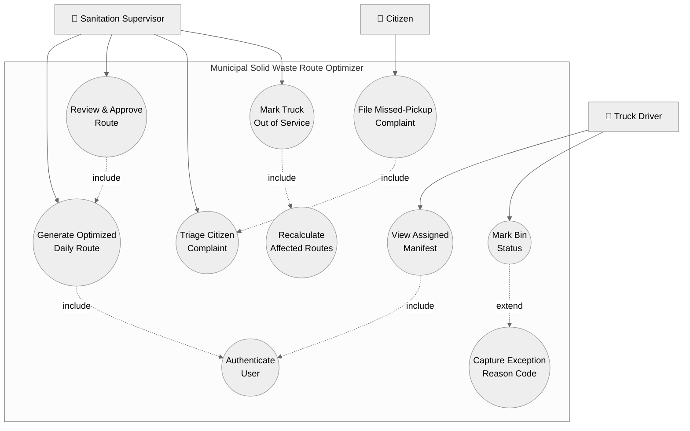

# Lab 1 — Requirements Engineering
## Municipal Solid Waste Route Optimizer

**Domain:** Smart Cities, Transport & Logistics
**Course:** CS393 — Software Engineering

---

## 1. Problem Context & Overview

The **Municipal Solid Waste Route Optimizer** is a city sanitation management portal that ingests ultrasonic fill-level data streamed from smart trash bins across the city, computes optimized daily collection routes for the sanitation truck fleet, and tracks and resolves citizen complaints about missed pickups. The system sits at the intersection of IoT sensing, logistics optimization, and public-service accountability: it must turn noisy real-time sensor telemetry into a trustworthy daily manifest that a driver can execute, while giving supervisors the oversight tools to intervene when the field reality (an overflowing bin, a broken-down truck, a citizen complaint) diverges from the plan.

**Target Stakeholders / Actors:**

| Actor | Role |
|---|---|
| **Sanitation Supervisor** | Configures thresholds, reviews and approves/edits generated routes, monitors fleet progress, triages citizen complaints, and reassigns work when exceptions occur. |
| **Truck Driver** | Receives the daily manifest on a mobile/in-cab device, executes the route stop-by-stop, marks bins collected, and flags issues (blocked access, overflow, bin damage) from the field. |

---

## 2. Requirements Table

### 2.1 Functional Requirements

| ID | Description | Priority | Acceptance Criteria | Rationale |
|---|---|---|---|---|
| **FR-001** | The system shall generate optimized daily collection routes, including only bins that have exceeded an 80% fill threshold (or are manually tagged for pickup by a Supervisor). | High | **Pass:** Route excludes bins < 80% full unless manually tagged. **Fail:** An overflowing bin (≥ 80%) is omitted from the driver's manifest. | Prevents wasted truck trips to near-empty bins while guaranteeing overflowing bins are never skipped — the core value proposition of the system. |
| **FR-002** | The system shall allow a Sanitation Supervisor to review, manually adjust (add/remove/reorder stops), and approve a generated route before it is dispatched to a driver. | High | **Pass:** Supervisor can add, remove, or reorder at least one stop and the change persists to the dispatched manifest. **Fail:** Route is sent to a driver without ever passing through an "Approved" state, or supervisor edits are silently discarded. | Automated routing cannot account for every local exception (road closures, VIP events); a human-in-the-loop approval gate is required before a route is legally/operationally binding. |
| **FR-003** | The system shall provide Truck Drivers a mobile interface to view their assigned manifest, mark each bin as "Collected," "Skipped," or "Inaccessible," and capture a mandatory reason code for any non-"Collected" status. | High | **Pass:** Driver cannot set a stop to "Skipped" or "Inaccessible" without selecting a reason code from a controlled list. **Fail:** A stop is closed out with no status, or a non-collected status has no reason recorded. | Reason codes are the raw data the Supervisor needs to resolve complaints and re-plan; unstructured or missing exception data breaks the feedback loop. |
| **FR-004** | The system shall allow citizens to submit a missed-pickup complaint (with bin ID or address, timestamp, and optional photo) and shall automatically link each complaint to the corresponding route stop and driver-reported status for that bin and date. | High | **Pass:** A complaint filed against a bin serviced that day is auto-linked to the matching manifest entry and its driver-reported status. **Fail:** A valid complaint is left unlinked/orphaned, or is linked to the wrong day's stop. | Auto-linking turns a citizen complaint into an auditable record ("bin marked Collected at 9:02 AM, complaint filed at 9:15 AM") instead of a he-said/she-said dispute. |
| **FR-005** | The system shall recompute an affected portion of the day's routes in real time whenever a Supervisor marks a truck as "Out of Service" mid-shift, reassigning that truck's remaining un-collected bins to the nearest available truck(s) with spare capacity. | Medium | **Pass:** Within one recalculation cycle, all remaining un-collected bins from the disabled truck appear on another active truck's manifest. **Fail:** Bins from a disabled truck are dropped from all manifests for the day. | Truck breakdowns are routine in fleet operations; without automatic reassignment, entire zones silently lose service for the day. |

### 2.2 Non-Functional Requirements

| ID | Type | Description | Priority | Acceptance Criteria | Rationale |
|---|---|---|---|---|---|
| **NFR-001** | Performance & Security | Route recalculation for a fleet of 50 trucks across 10,000 bins shall execute in under 45 seconds, and all sensor and route data in transit/at rest shall be encrypted (TLS 1.2+ / AES-256). | High | **Pass:** Benchmarking tests confirm target latency and security standards under simulated peak load. **Fail:** Recalculation exceeds 45 s, or a security scan finds unencrypted data in transit or at rest. | Supervisors need near-real-time replanning during exceptions (FR-005), and the system handles sensitive municipal infrastructure and citizen PII, making both speed and security non-negotiable. |
| **NFR-002** | Reliability & Usability | The driver mobile interface shall remain functional in offline/low-connectivity mode (caching the day's manifest locally and queuing status updates for sync), and the system shall guarantee 99.5% monthly uptime for the Supervisor portal. | High | **Pass:** Driver can view manifest and mark bin statuses with no network signal; queued updates sync automatically within 60 seconds of reconnection. Uptime logs show ≥ 99.5% availability over a rolling 30-day window. **Fail:** Driver app is unusable without connectivity, or monthly uptime falls below 99.5%. | Collection routes frequently pass through basements, industrial zones, and dead spots with poor cellular coverage; a driver blocked from working by a network gap directly breaks service delivery. |

---

## 3. UML Use-Case Diagram

**Relationships modeled:**
- **`<<include>>`** — `Review & Approve Route` *includes* `Generate Optimized Daily Route` (a route must always be generated before it can be reviewed; the base use case cannot complete without it).
- **`<<include>>`** — `Mark Truck Out of Service` *includes* `Recalculate Affected Routes` (marking a truck down mandatorily triggers reassignment, per FR-005).
- **`<<include>>`** — `File Missed-Pickup Complaint` *includes* `Triage Citizen Complaint` (every submitted complaint is guaranteed to enter the Supervisor's triage queue).
- **`<<extend>>`** — `Capture Exception Reason Code` *extends* `Mark Bin Status`, and only fires **conditionally** — when the Driver selects "Skipped" or "Inaccessible" rather than "Collected" (per FR-003).
- **`<<include>>`** — `Generate Optimized Daily Route` and `View Assigned Manifest` both *include* `Authenticate User`, a common precondition shared across the base use cases.

---

## 4. Use-Case Flow Specification

### Use Case: **UC-01 — Generate Optimized Daily Route**

**Actor(s):** Sanitation Supervisor (primary), System (Route Optimization Engine)

**Trigger:** Supervisor initiates route generation for the upcoming shift (typically the start of a business day), or the system's scheduled nightly batch job fires automatically.

#### Preconditions
1. The Supervisor is authenticated and holds an active session with route-planning privileges.
2. Live fill-level telemetry has been received from smart bins within the last 30 minutes (data freshness check).
3. At least one truck in the fleet is marked "Available" for the target shift, with a valid depot start location and capacity.
4. The city's bin and road-network map data is loaded and current.

#### Postconditions
- **Success:** A candidate route (or set of routes, one per truck) exists in "Pending Review" state, containing only bins at or above the 80% fill threshold (plus any manually tagged bins), sequenced to minimize total travel distance/time within each truck's capacity.
- **Failure:** No route is generated; the system surfaces a specific error (e.g., "No bins exceed threshold," "No available trucks," "Stale sensor data") and the prior day's route state, if any, remains unaffected.

#### Main Success Scenario
1. Supervisor selects "Generate Route" for a target date and zone (or accepts the nightly auto-trigger).
2. System queries the latest fill-level reading for every bin in the selected zone.
3. System filters the bin set to those with fill-level ≥ 80%, and unions in any bins the Supervisor has manually tagged for inclusion.
4. System retrieves the list of available trucks, their capacities, and depot locations for the shift.
5. System runs the route-optimization algorithm, assigning filtered bins to trucks and sequencing stops to minimize total distance/time, respecting each truck's capacity constraint.
6. System computes an estimated completion time and total distance for each truck's route.
7. System saves the generated route(s) in "Pending Review" status and notifies the Supervisor that a route is ready for review.
8. Supervisor is presented with a summary (bin count, truck count, estimated duration) and proceeds to UC-02 (Review & Approve Route).

#### Alternate Flow — A1: No Bins Exceed Threshold
- **Branch point:** Step 3 (after filtering).
- 3a. System determines that zero bins meet the ≥ 80% threshold and no bins have been manually tagged.
- 3b. System does **not** proceed to truck assignment; instead it logs the zone as "No collection required" for the target date.
- 3c. System notifies the Supervisor with a summary message ("0 bins require collection in Zone [X] for [date]") rather than an error, since this is a valid operational outcome.
- 3d. Use case ends without entering "Pending Review" state; no manifest is created or dispatched.

---

*End of Lab 1 submission document.*
